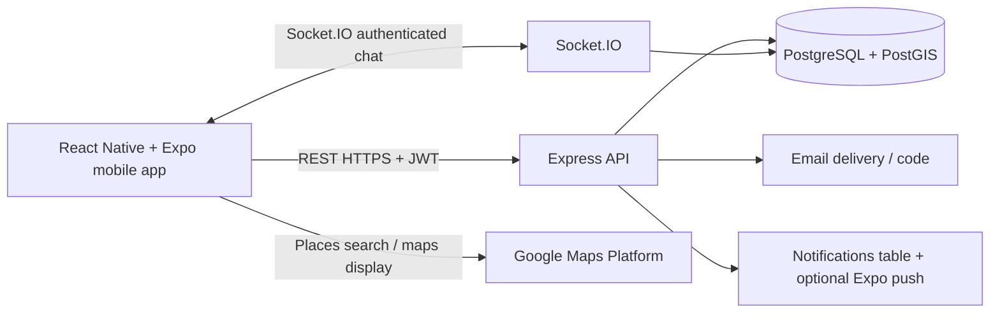
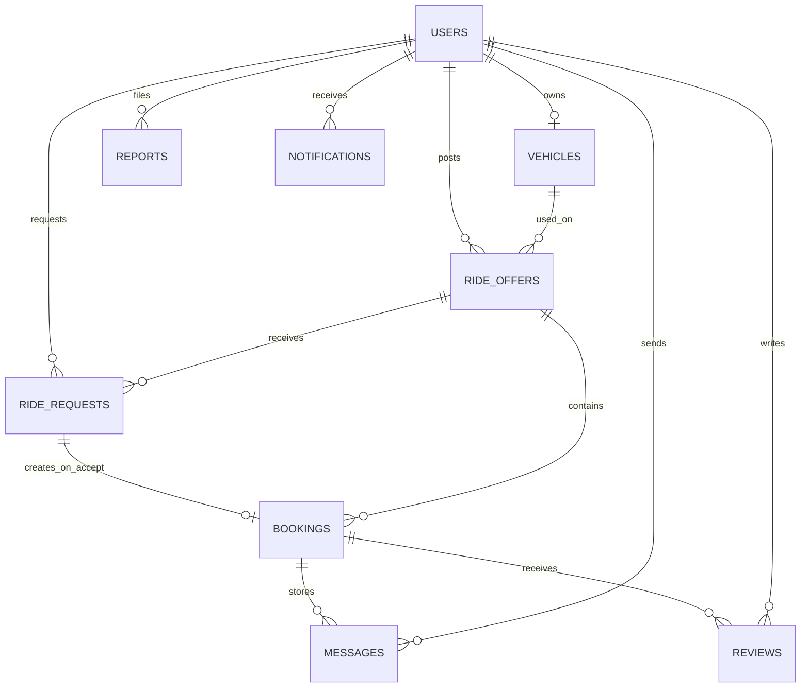

# Backend architecture and requirements traceability

**Responsible team member:** Himal Gautam — backend/database, PostgreSQL/PostGIS, real-time chat. This package is designed to integrate with the team's **React Native + Expo** app; it does not replace anyone else's UI or Google Maps screen work.

## Architecture

The controllers/routes are separate from persistence (PostgreSQL) and notifications, consistent with an MVC-inspired separation. Socket.IO uses publish/subscribe style events in booking rooms, analogous to Observer. No microservice complexity is needed for a four-person semester project.

## Data relationships

`ride_offers.origin` and `.destination` are PostGIS geography points (`SRID 4326`), with GiST indexes. Origin/destination JSON is `{lat,lng,label}`. Query distances are **meters** rather than degrees. Ride search is indexed by time and two geospatial positions.

## Transactional acceptance guarantee

1. Request enters PENDING (no seats deducted yet).
2. Driver accepts; server starts database transaction.
3. Transaction `SELECT ... FOR UPDATE` locks the parent `ride_offers` row, so concurrent accepts for that ride wait their turn.
4. Lock the request, require PENDING, valid open ride and enough seats.
5. Decrement `seats_available`, set request ACCEPTED, insert exactly one booking (`UNIQUE request_id`).
6. Commit all changes together. If there is an error, roll back everything. Emit notification **after** commit.

This covers the UML seat-check sequence (SD-11 and SD-12) and FR-12. It is the most important integrity rule in the entire backend.

## Requirement mapping from the uploaded SRS and UML

| Requirement | Delivered in |
|---|---|
| FR-01 Register UNT email | `routes/auth.js` + `users` |
| FR-02 Email verification | `routes/auth.js`, `email_verification` + email service |
| FR-03 Login / logout | JWT login in `auth.js`; logout is client token deletion per UML |
| FR-04 Edit profile | `routes/users.js` |
| FR-05 Vehicle information | `routes/vehicles.js` |
| FR-06 Post ride | `routes/rides.js` |
| FR-07 Edit/cancel ride | `routes/rides.js` |
| FR-08 Search by pickup/destination/time | `routes/rides.js` + PostGIS `ST_DWithin` |
| FR-09 Ranked matches | `lib/matching.js` |
| FR-10 Request a seat | `POST /api/rides/:id/requests` |
| FR-11 Driver accept/reject | `routes/requests.js` |
| FR-12 Prevent overbooking | Locked transaction `routes/requests.js` + DB check |
| FR-13 Upcoming/history | `/api/bookings`, `/api/rides/mine`, `/api/requests/mine` |
| FR-14 Chat only for bookings | `socket.js` + `messages` + `/api/bookings/:id/messages` |
| FR-15 Notifications | DB notification rows + optional Expo push (`services/notifications.js`) |
| FR-16 Review after completed ride | `/api/reviews` |
| FR-17 Report user | `POST /api/reports` |
| FR-18 Admin moderation | admin report list, resolve, suspend routes |

## Honest status of execution

**Implemented in source:** schema, PostGIS queries, authentication, role/ownership enforcement, ride workflows, chat persistence/events, notifications, report/review endpoints, schema setup, synthetic full-flow smoke script, and five matching unit tests.

**Verified in the generation environment:** all JS files pass Node's syntax parser; all five matching tests pass.

**Not yet verified end-to-end:** starting PostgreSQL, applying migrations, installing npm packages, running the live Express/Socket.IO service, handling real Expo clients, SMTP and push deliveries. Those require Docker/npm/credentials that were not available here. Run `npm run smoke` after bootstrapping locally to verify and debug integration before merging to the shared repository.

## Next steps for the team

- **Himal:** initialize PostGIS DB; run migration; execute smoke test; create backend branch and open PR; agree with teammates on geospatial matching thresholds.
- **Frontend contributor:** call the documented endpoints; send Google Maps-selected GPS coordinates; implement token storage, verified signup and ride request/driver acceptance screens; connect booking-scoped Socket.IO chat.
- **Team:** decide if real ride fees/recurring schedules from extended wireframe belong in scope; finish integration acceptance test; connect SMTP/Expo test credentials if notifications will be demonstrated.

The backend follows the **SRS/UML's driver-accepted booking** semantics. The wireframe sometimes shows "Confirm ride" as though it books immediately, and also introduces estimated cost sharing and recurring rides; those differences should be resolved in the team's UX review, not silently implemented as payment or automatic booking.
